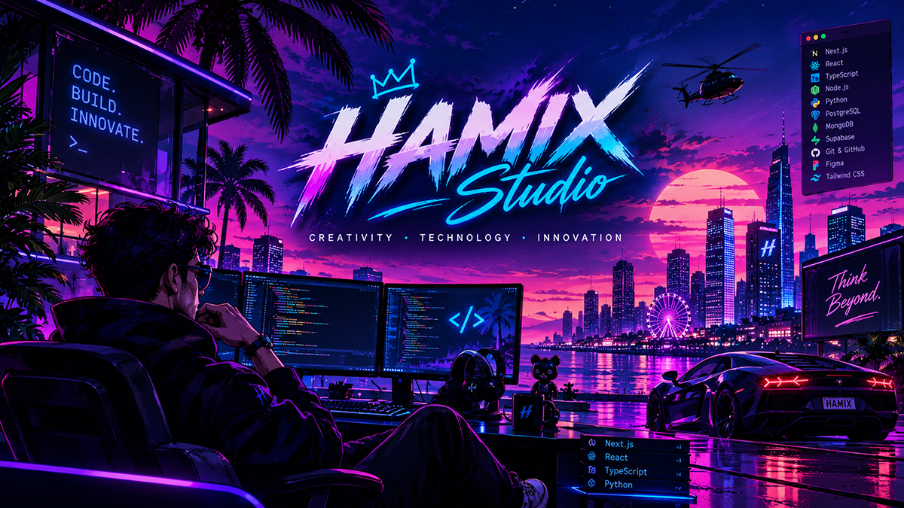

  

### CREATIVITY. TECHNOLOGY. INNOVATION.

---

## ABOUT

**HAMIX** is an independent digital brand driven by creativity and technology.

We transform ideas into digital experiences through thoughtful design, modern development, and a constant desire to explore what's possible.

**Think beyond. Create without limits.**

---

## WHAT WE DO

 

**01 — DIGITAL EXPERIENCES**

Creating modern and engaging digital environments.

 

**02 — SOFTWARE DEVELOPMENT**

Turning concepts into functional solutions.

 

**03 — CREATIVE TECHNOLOGY**

Exploring ideas and pushing technological boundaries.

 

**04 — INNOVATION**

Learning, experimenting, and building what comes next.

---

## TECHNOLOGY STACK

 

---

### HAMIX

**BEYOND IDEAS. INTO REALITY.**

© HAMIX — All Rights Reserved.

